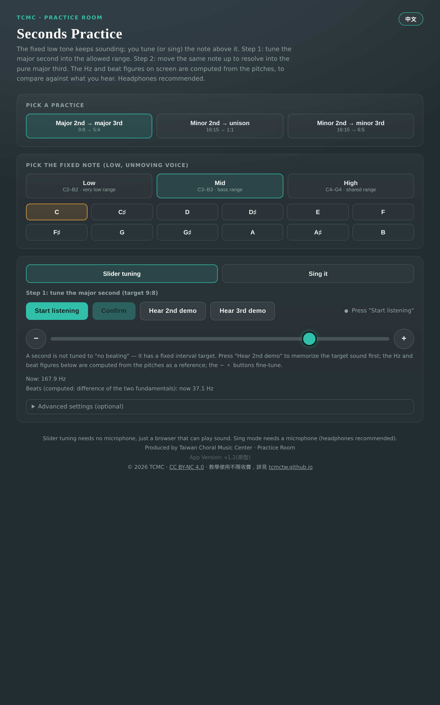
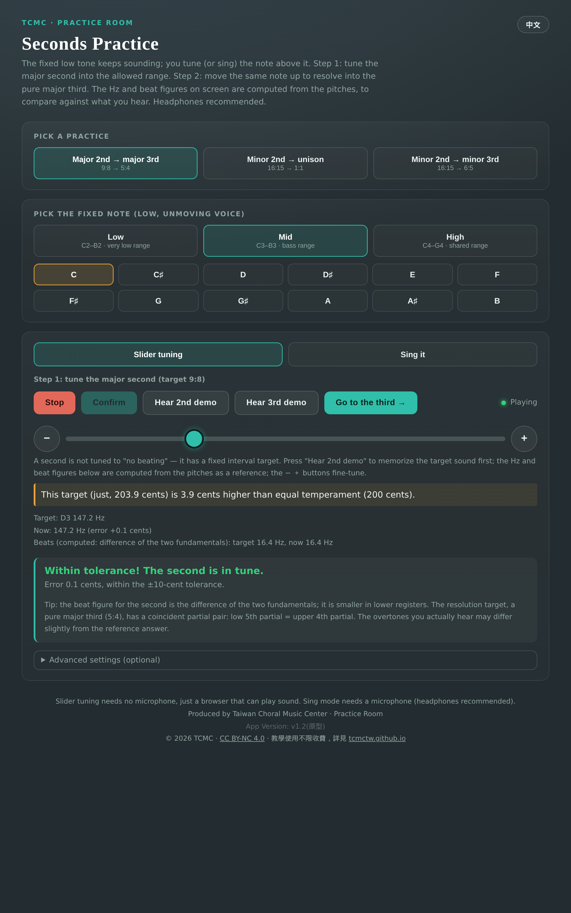
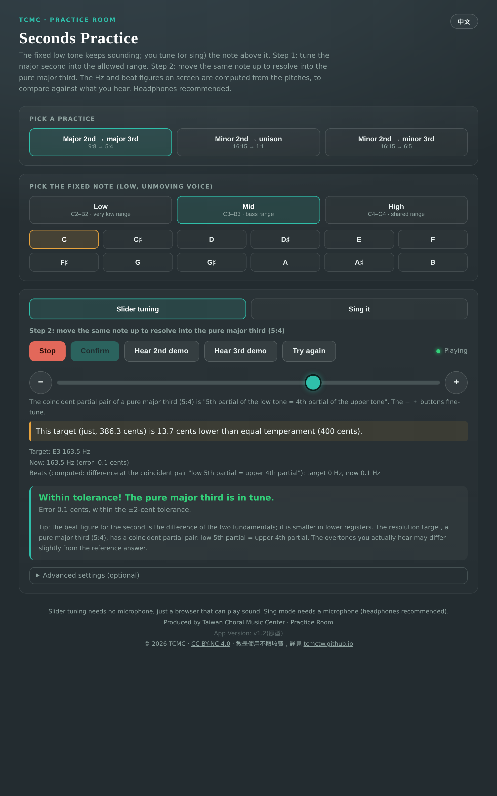
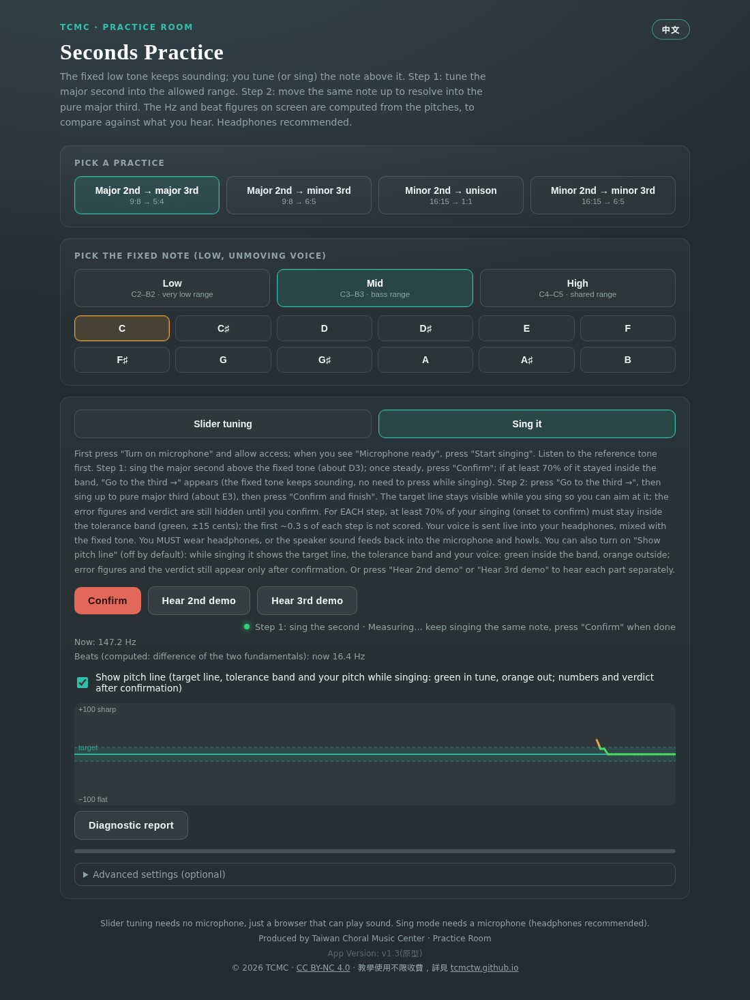
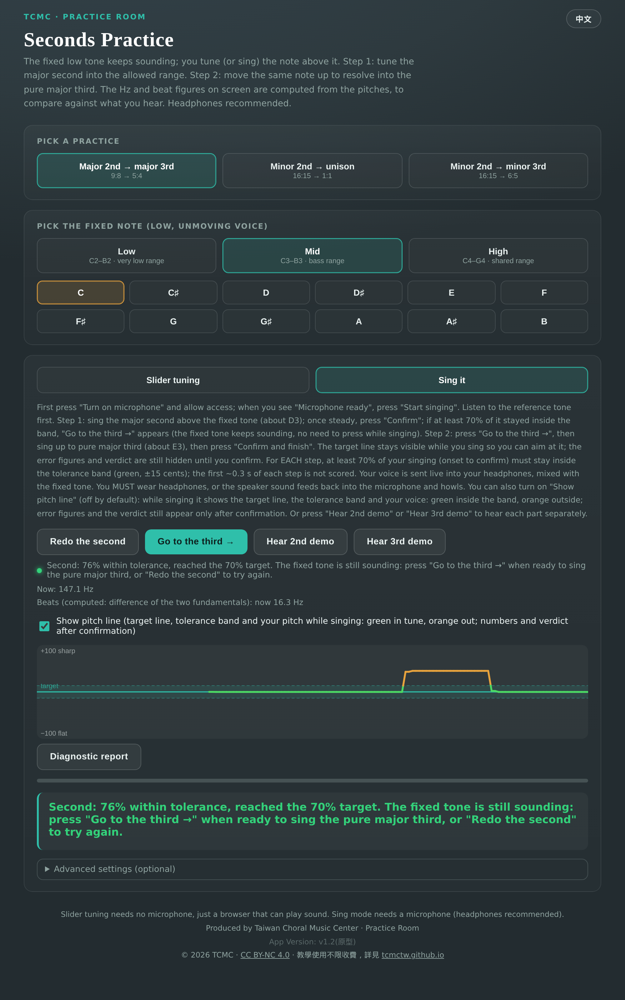
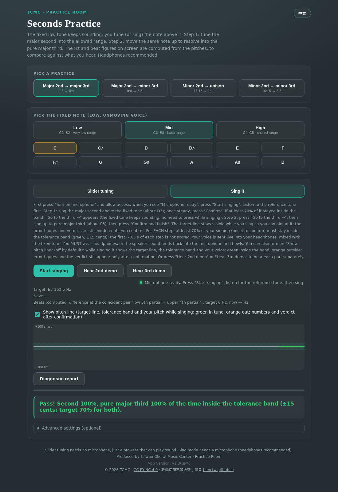
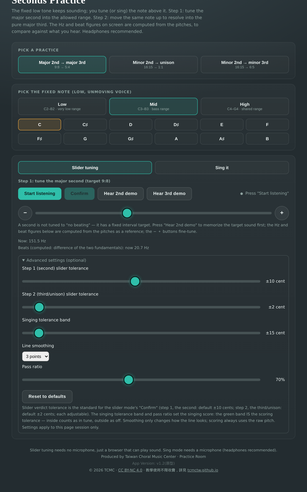

# Seconds Practice - User Manual

Version v1.3 (prototype) · Made by Taiwan Choral Music Center (TCMC) · CC BY-NC 4.0

## What this tool does

Seconds (major and minor) are everywhere in modern harmony (sus chords), but they are hard to hear accurately. This trainer has you tune a second first, then resolve the same note to a third or unison - training the "second → resolution" reflex.

Four practice paths:

- **Major 2nd → major 3rd** (9:8 → 5:4)
- **Major 2nd → minor 3rd** (9:8 → 6:5)
- **Minor 2nd → unison** (16:15 → 1:1)
- **Minor 2nd → minor 3rd** (16:15 → 6:5)

Two ways to practice: **Slider tuning** (no microphone needed) and **Sing** (microphone, live pitch judgment).

## Before you start

- Any browser that plays sound works; Sing mode needs a microphone.
- Headphones recommended - the two tones mix like live choral singing. Sing mode **requires** headphones, or the speaker feeds back into the mic and howls.
- Works on phone and computer. On touch screens the slider is relative-drag: tapping the track does not jump the value, lifting your finger does not drift; the − ＋ buttons nudge.
- On iPhone, open the tool from its web link; opening the HTML file directly from the Files app only shows a file icon.

## Choosing a practice and the fixed note

1. **Choose a practice**: one of the four paths (M2 → M3 / M2 → m3 / m2 → unison / m2 → m3).
2. **Choose the fixed note** (the low, unmoving voice part): pick a register - Low (C2–B2, very low), Mid (C3–B3, bass range), High (C4–C5, shared range) - then a note (C through B, plus the top C5 in the High register).

The fixed note keeps sounding; you tune (or sing) the note above it.

## Slider tuning

1. Press **Start listening** - the fixed note sounds continuously.
2. **Step 1: tune the second.** Drag the slider to tune the upper note. A second is not "beats disappear" but a fixed interval target; press **Hear 2nd demo** first to memorize the target sound. Only the current Hz and beat rate are shown while tuning.
3. Press **Confirm**: the target note, target Hz, error in cents and the verdict appear. Step-1 default tolerance is **±10 cents** (seconds are hard to tell apart, so the bar is wider).
4. After passing, press **Go to the third →** (the button follows the target: "Go to the third →", "Go to the minor third →", or "Go to unison →").
5. **Step 2: resolve.** Move the same note up (M3 / m3) or down (unison) and confirm again. Step-2 default tolerance is **±2 cents**, the same standard as Tune to Pure unison.
6. After the verdict, use **Your answer / Correct answer** to A/B compare, then **Try again**.

## Sing mode

1. Press **Turn on microphone**, allow access, wait for "Microphone ready", then press **Start singing**. (Mac Safari may take a few seconds to start the mic.)
2. Listen to the fixed note first, then start. **Step 1**: sing the second above the fixed note; when steady, press **Confirm**. If at least **70%** of the time from voice onset to Confirm stayed inside the tolerance band (±15 cents), **Go to the third →** appears (the button follows the target: "Go to the third →", "Go to the minor third →", or "Go to unison →"). The fixed tone keeps sounding, so you can stop, get ready, and press it when ready - no need to press anything while singing. To redo this step, press **Redo the second**; if you missed the target, press **Start singing** to sing the second again.
3. **Step 2**: after pressing "Go to the third →", sing up to the third (or down to unison), then press **Confirm and finish**.
4. **Scoring**: for each step, at least **70%** of the time from voice onset to confirm must stay inside the tolerance band (green band, ±15 cents); the first ~0.3 s of each step is not scored. Both steps must pass.
5. Your voice is mixed live into your headphones with the fixed note so you can hear the beating - judge mainly by ear. If you hear no beats, the volume difference may be too large or the partials too weak; turn on the pitch line to check.
6. **Show pitch line** (off by default): while singing it shows the target line, the tolerance band and your pitch - green inside the band, orange outside, above the line = sharp, below = flat. Error numbers and the verdict appear only after you confirm.
7. **Diagnostic report**: downloads a PDF. The report lists the two intervals separately - in-band / sharp / flat percentages for the second and for the third (or unison), matching the numbers on screen - plus the recognized voiced time, the overall verdict and practice advice. If a part was too short or barely heard, the report says "cannot judge" or "not sung yet" instead of counting it as wrong.

## Advanced settings (optional)

- **Step-1 (second) slider tolerance**: default ±10 cents
- **Step-2 (third/unison) slider tolerance**: default ±2 cents
- **Singing tolerance band**: default ±15 cents (the green band is the scoring band)
- **Line smoothing**: default 3 points (display only - scoring always uses raw pitch)
- **Pass ratio**: default 70%
- Settings apply only to this session; **Reset to defaults** restores them.

## FAQ

- **Can't tune the second?** Seconds are genuinely hard to tell apart; the tolerance is already wider. Use the 2nd demo to memorize the sound, then slide slowly.
- **Can't hear beats?** The volume difference may be too large or the partials too weak; turn on the pitch line, or try another register.
- **No sound?** Check device volume and that the browser is allowed to play audio; on iPhone, don't use silent mode.

---

© 2026 Taiwan Choral Music Center (TCMC) · Licensed CC BY-NC 4.0 · Free for teaching use, see tcmctw.github.io
