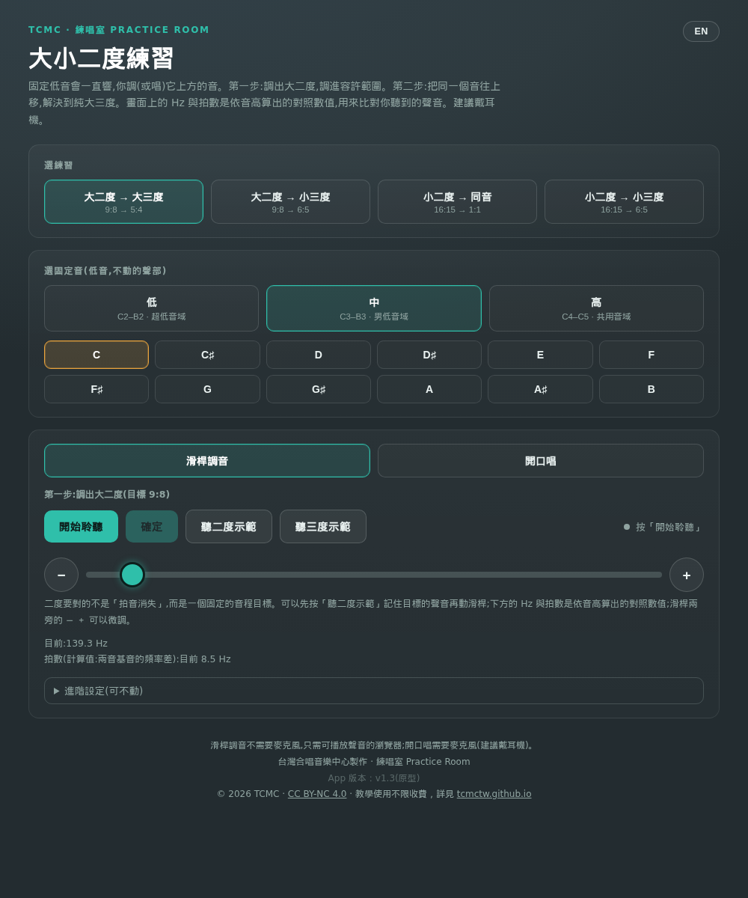
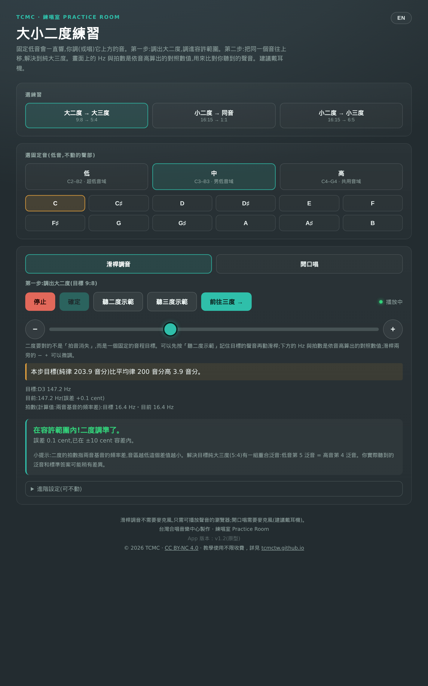
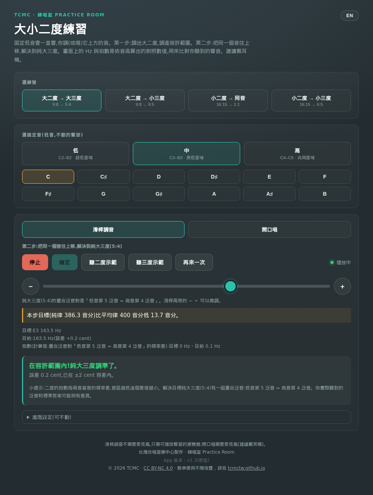
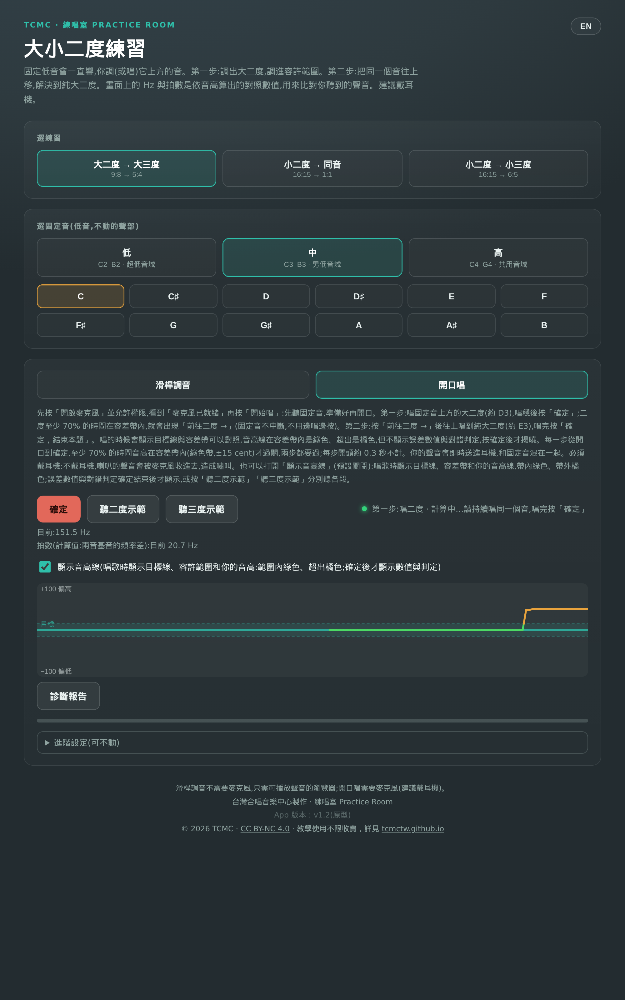
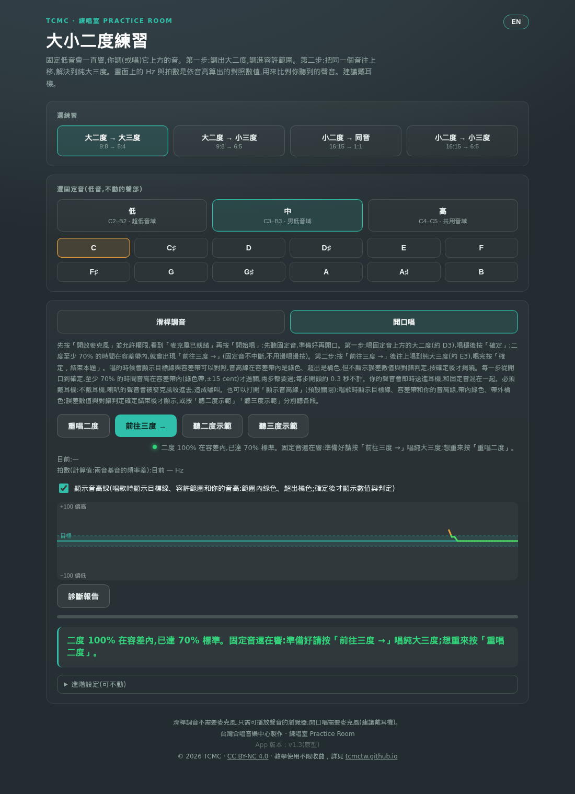
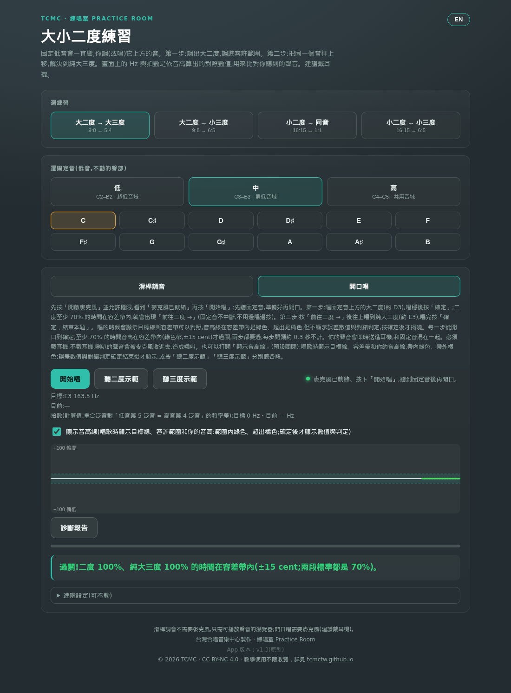
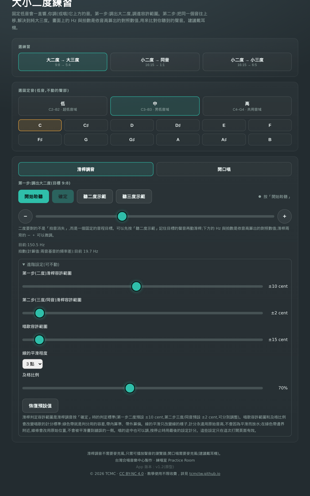

# 大小二度練習 使用手冊

版本 v1.3（原型）· 台灣合唱音樂中心製作 · CC BY-NC 4.0

## 這個工具在做什麼

二度（大二度、小二度）在現代和聲裡很常見（sus 和弦），但二度很難聽準。這個練習讓你先調出二度，再把同一個音解決到三度或同音，訓練「二度 → 解決」的聽感。

四種練習路徑：

- **大二度 → 大三度**（9:8 → 5:4）
- **大二度 → 小三度**（9:8 → 6:5）
- **小二度 → 同音**（16:15 → 1:1）
- **小二度 → 小三度**（16:15 → 6:5）

有兩種練法：**滑桿調音**（用滑桿調出音程，不需要麥克風）和**開口唱**（用麥克風唱，即時判定音準）。

## 開始之前

- 只需要能播放聲音的瀏覽器；「開口唱」模式需要麥克風。
- 建議戴耳機：兩個音會混在一起，和現場合唱一樣。「開口唱」**必須**戴耳機，否則喇叭的聲音會被麥克風收進去，造成嘯叫。
- 手機、電腦都能用。手機上滑桿是「相對拖曳」：點軌道不會跳值、手指放開不會漂移，兩旁的 − ＋ 可以微調。
- iPhone 請用網址開啟；從「檔案」App 直接開 HTML 只會看到檔案圖示，不會執行。

## 選練習與固定音

1. **選練習**：四個按鈕選一條路徑（大二度 → 大三度／大二度 → 小三度／小二度 → 同音／小二度 → 小三度）。
2. **選固定音**（低音，不動的聲部）：先選音域 - 低（C2–B2，超低音域）、中（C3–B3，男低音域）、高（C4–C5，共用音域）- 再選音（低、中音域為 C 到 B 十二個音，高音域另有最高 C5）。

固定音會一直響，你調（或唱）它上方的音。

## 滑桿調音

1. 按「**開始聆聽**」，固定音開始持續發聲。
2. **第一步：調出二度。** 拖滑桿調整上方的音。二度要對的不是「拍音消失」，而是一個固定的音程目標；可以先按「**聽二度示範**」記住目標的聲音再調。畫面上只顯示目前的 Hz 與拍數（依音高算出的對照數值）。
3. 按「**確定**」：顯示目標音、目標 Hz、誤差 cent 與判定。第一步預設容差 **±10 cent**（二度很難聽出差別，標準比三度寬）。
4. 通過後按「**前往三度 →**」（依解決目標顯示「前往三度 →」「前往小三度 →」或「前往同音 →」）。
5. **第二步：解決。** 把同一個音往上（大三度／小三度）或往下（同音）移動，再按「確定」。第二步預設容差 **±2 cent**，和調到沒拍音的齊唱標準相同。
6. 判定後可以按「**你的答案／正確答案**」A/B 對照聽，再按「再來一次」練下一題。

## 開口唱

1. 按「**開啟麥克風**」並允許權限，看到「麥克風已就緒」再按「**開始唱**」。（Mac Safari 麥克風啟動可能要等幾秒。）
2. 先聽固定音，準備好再開口。**第一步**：唱固定音上方的二度，唱穩後按「**確定**」。從開口到按確定至少 **70%** 的時間在容差帶內（±15 cent），就會出現「**前往三度 →**」（依解決目標顯示「前往三度 →」「前往小三度 →」或「前往同音 →」）。固定音不會中斷，可以停下來準備好再按，不用邊唱邊按。想重唱這段按「**重唱二度**」；沒達標的話按「**開始唱**」重唱二度。
3. **第二步**：按「前往三度 →」後，往上唱到三度（或往下唱到同音），唱完按「**確定，結束本題**」。
4. **判定**：每一步從開口到確定，至少 **70%** 的時間音高在容差帶內（綠色帶，±15 cent）就過關，兩步都要過；每一步開頭約 0.3 秒不計。
5. 你的聲音會即時送進耳機，和固定音混在一起，讓你聽出拍音 - 準不準主要靠聽；聽不到拍音也可能是音量差太多或相關泛音太弱，不確定時可以打開音高線對照。
6. 「**顯示音高線**」（預設關閉）：唱歌時顯示目標線、容差帶和你的音高線 - 帶內綠色、超出橘色，線上方＝偏高、下方＝偏低；誤差數值與對錯判定確定後才顯示。
7. 「**診斷報告**」：下載中文 PDF。報告把兩段音程分列 - 二度與三度（或同音）各自的帶內／偏高／偏低百分比，和畫面上的數字一致 - 並附上成功辨識音高的時間、整題判定與練習建議。某一段收到的聲音太短或幾乎沒有時，會明確寫「無法判定」或「還沒唱」，不算唱錯。

## 進階設定（可不動）

- **第一步（二度）滑桿容許範圍**：預設 ±10 cent
- **第二步（三度／同音）滑桿容許範圍**：預設 ±2 cent
- **唱歌容許範圍**：預設 ±15 cent（綠色帶就是判分用的容差）
- **線的平滑程度**：預設 3 點（只改變線的樣子，計分永遠用原始音高）
- **及格比例**：預設 70%
- 這些設定只在這次打開頁面有效；按「**恢復預設值**」可還原。

## 常見問題

- **二度調不準？** 二度本來就很難聽出差別，容差已放寬；先用「聽二度示範」記住聲音，再慢慢滑。
- **聽不到拍音？** 可能是兩個音音量差太多，或相關泛音太弱；打開「顯示音高線」對照，或先練別的音域。
- **頁面沒有聲音？** 確認裝置音量與瀏覽器允許播放；iPhone 請勿用靜音模式。

---

© 2026 台灣合唱音樂中心（TCMC）· 本工具以 CC BY-NC 4.0 授權 · 教學使用不限收費，詳見 tcmctw.github.io
